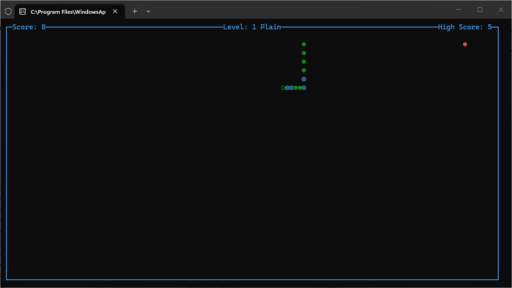

<div align="center">

# 🐍 Snake CLI

**Classic Snake for your terminal — playable on Windows, macOS and Linux.**

[](https://www.python.org/)


**English** · [Polski](docs/readme.pl.md)

</div>

<div align="center">



</div>

---

Snake CLI is a small, dependency-free terminal game. Move a snake around a bordered
board, eat the food, grow longer, and don't hit the walls, the level obstacles or your
own tail. The score, level and high score are shown in the window title bar area, and
the best result is saved between sessions.

## Features

- 🎮 **Keyboard controls** — arrow keys or WASD.
- 🚫 **Reverse-turn protection** — you cannot instantly turn 180° into yourself.
- 🏆 **Persistent high score** — saved to a plain text file next to the script.
- 📈 **Levels with speed ramp-up** — a new level starts at the target score and the game gets faster.
- 🧱 **Level obstacles** — walls are drawn from the level definition.
- 🖥️ **Start menu** — Start Game, Instructions, Quit.
- 🔁 **Restart / quit screen** — press `r` to start again or `q` to exit.
- 🎨 **Portable rendering** — ncurses block glyphs on Unix, ASCII fallback on Windows.

## Requirements

| Requirement | Details |
|---|---|
| Python | 3.9 or newer (on this machine: 3.12 or 3.14) |
| `curses` | Standard on macOS / Linux |
| `windows-curses` | Required on Windows (`pip install windows-curses`) |

> **Windows note:** Python for Windows does not ship `_curses`. Install it with
> `pip install windows-curses`. PyPI currently publishes wheels up to **CPython 3.14** —
> Python **3.15** cannot run the game until a matching wheel exists. Use Python 3.14
> (or 3.12) on this machine.

## Installation

```powershell
# 1. Get the files
git clone <repository-url>
cd Snake_Cli_The_Game

# 2. Install the curses backend (Windows only)
python -m pip install windows-curses
```

macOS/Linux users can skip step 2 — the standard library already contains `curses`.

## Run

**Windows (recommended)** — the helper script picks an interpreter that has `curses`
and fails with a readable message if none is found:

```powershell
.\run_snake.ps1
```

You can point it at a specific interpreter:

```powershell
.\run_snake.ps1 -PythonExe "C:\Python314\python.exe"
```

**Any platform**

```powershell
python "Snake CLI.py"
```

> If the terminal asks you to select an app for `.py` files, run it explicitly:
> `& "C:\Users\<you>\AppData\Local\Programs\Python\Python314\python.exe" "Snake CLI.py"`

## Controls

| Key | Action |
|---|---|
| `↑` `↓` `←` `→` | Move the snake |
| `W` `A` `S` `D` | Move the snake |
| `Enter` / `S` | Start the game from the main menu |
| `I` | Show instructions |
| `Q` / `Esc` | Quit |
| `R` | Restart after Game Over |
| `Q` | Quit after Game Over |

## Gameplay

1. Press `Enter` in the main menu to start.
2. Each `*` you eat adds **1 point** and one segment to the snake.
3. Reaching the level's target score advances you to the next level — the snake moves faster.
4. Game over when the head touches the border, a level wall, or the snake's own body.
5. A new record is written to the high-score file immediately.

## Project structure

```text
Snake_Cli_The_Game/
├── Snake CLI.py            # Game source: menu, game loop, rendering
├── run_snake.ps1           # Windows launcher (validates curses, then starts the game)
├── high_score.txt          # Saved high score (created on first record)
├── README.md               # This file (English)
├── tests/
│   ├── run_tests.ps1       # Test runner (runs every test in this folder)
│   ├── smoke_test_curses.py# Headless smoke test (menu + one game frame)
│   └── smoke_out.txt       # Output of the last smoke test run
└── docs/
    ├── readme.pl.md        # Polish version of this document
    ├── p.txt               # One-paragraph program summary
    └── screenshot.png      # Screenshot used above
```

## Testing

All tests live in `tests/` and are run from there.

```powershell
# From the repository root
.\tests\run_tests.ps1

# Or explicitly with an interpreter that has curses
& "C:\Users\<you>\AppData\Local\Programs\Python\Python314\python.exe" .\tests\smoke_test_curses.py
```

`run_tests.ps1` prints the collected output. The smoke test writes its result to
`tests\smoke_out.txt`: `smoke test OK: <path to python>` on success.

## Troubleshooting

| Symptom | Cause / Fix |
|---|---|
| `ModuleNotFoundError: No module named '_curses'` | `curses` is missing. On Windows: `pip install windows-curses`, then use that interpreter. |
| `No matching distribution found for windows-curses` | Your Python version has no wheel yet (e.g. 3.15). Use Python 3.12–3.14. |
| `AttributeError: module 'curses' has no attribute 'ACS_...'` | The game already falls back to ASCII glyphs; older builds needed `ACS_CKBOARD` / `ACS_PI`. |
| Snake is invisible or the board looks empty | Terminal too small or font issue — resize the window, then restart. |
| High score resets to 0 | The folder is read-only or `high_score.txt` is corrupted; the game falls back to 0. |
| `Redirection is not supported` (PowerShell) | Piping curses output is not possible — run the game directly in the console. |

## License

Released under the MIT License.

## Credits

- Game: **Sebastian Januchowski — polsoft.ITS™**
- Curses bindings for Windows: [windows-curses](https://github.com/zephyrproject-rtos/windows-curses)
