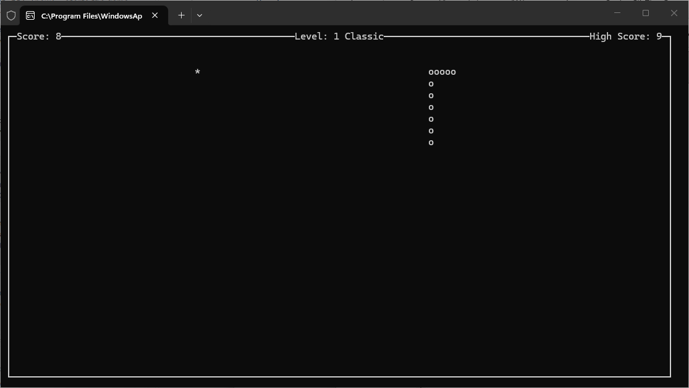

<div align="center">

# 🐍 Snake CLI

**Klasyczny Snake w twoim terminalu — działa na Windows, macOS i Linuksie.**

[](https://www.python.org/)


[English](../README.md) · **Polski**

</div>

<div align="center">



</div>

---

Snake CLI to mała gra terminalowa bez zewnętrznych bibliotek. Prowadzisz węża po planszy
otoczonej ramką, zjadasz jedzenie, rośniesz i nie możesz uderzyć w ścianę, przeszkodę
poziomu ani we własny ogon. Wynik, poziom i rekord są widoczne w górnej krawędzi okna,
a najlepszy rezultat zapisuje się między sesjami.

## Funkcje

- 🎮 **Sterowanie z klawiatury** — strzałki lub WASD.
- 🚫 **Blokada zawracania** — nie można w jednym ruchu skręcić o 180° we własne ciało.
- 🏆 **Rekord trwale zapisywany** — w prostym pliku tekstowym obok skryptu.
- 📈 **Poziomy z przyspieszaniem** — po zdobyciu progu punktowego startuje kolejny poziom, a gra przyspiesza.
- 🧱 **Przeszkody na poziomach** — ściany rysowane na podstawie definicji poziomu.
- 🖥️ **Menu startowe** — Start gry, Instrukcja, Wyjście.
- 🔁 **Ekran po przegranej** — `r` zaczyna od nowa, `q` kończy grę.
- 🎨 **Przenośne rysowanie** — znaki blokowe ncurses na Unixie, zastępcze znaki ASCII na Windows.

## Wymagania

| Wymaganie | Szczegóły |
|---|---|
| Python | 3.9 lub nowszy (na tym komputerze: 3.12 lub 3.14) |
| `curses` | Standardowo dostępny w macOS / Linuksie |
| `windows-curses` | Wymagany na Windows (`pip install windows-curses`) |

> **Uwaga dla Windows:** Python dla Windows nie zawiera modułu `_curses`. Należy go
> doinstalować: `pip install windows-curses`. PyPI udostępnia obecnie paczki (wheels)
> najwyżej dla **CPython 3.14** — Python **3.15** nie uruchomi gry, dopóki nie pojawi się
> odpowiednia paczka. Na tym komputerze używaj Pythona 3.14 (lub 3.12).

## Instalacja

```powershell
# 1. Pobierz pliki
git clone <adres-repozytorium>
cd Snake_Cli_The_Game

# 2. Zainstaluj obsługę curses (tylko Windows)
python -m pip install windows-curses
```

Użytkownicy macOS/Linuxa mogą pominąć krok 2 — `curses` jest częścią biblioteki standardowej.

## Uruchamianie

**Windows (zalecane)** — skrypt pomocniczy wybiera interpreter z dostępnym `curses`
i w razie problemu wypisuje czytelny komunikat:

```powershell
.\run_snake.ps1
```

Możesz wskazać konkretny interpreter:

```powershell
.\run_snake.ps1 -PythonExe "C:\Python314\python.exe"
```

**Każdy system**

```powershell
python "Snake CLI.py"
```

> Jeśli terminal proponuje wybór aplikacji dla plików `.py`, uruchom grę jawnie:
> `& "C:\Users\<ty>\AppData\Local\Programs\Python\Python314\python.exe" "Snake CLI.py"`

## Sterowanie

| Klawisz | Działanie |
|---|---|
| `↑` `↓` `←` `→` | Ruch węża |
| `W` `A` `S` `D` | Ruch węża |
| `Enter` / `S` | Start gry z menu głównego |
| `I` | Instrukcja |
| `Q` / `Esc` | Wyjście |
| `R` | Restart po przegranej |
| `Q` | Wyjście po przegranej |

## Rozgrywka

1. W menu głównym naciśnij `Enter`, aby rozpocząć.
2. Każde zjedzone `*` daje **1 punkt** i wydłuża węża o jeden segment.
3. Osiągnięcie progu punktowego poziomu przenosi na kolejny poziom — wąż porusza się szybciej.
4. Koniec gry, gdy głowa dotknie ramki, ściany poziomu lub własnego ciała.
5. Nowy rekord zostaje od razu zapisany w pliku wyniku.

## Struktura projektu

```text
Snake_Cli_The_Game/
├── Snake CLI.py            # Kod gry: menu, pętla gry, rysowanie
├── run_snake.ps1           # Launcher dla Windows (sprawdza curses i startuje grę)
├── high_score.txt          # Zapisany rekord (tworzony przy pierwszym wyniku)
├── README.md               # Dokumentacja po angielsku
├── tests/
│   ├── run_tests.ps1       # Uruchamia wszystkie testy z tego folderu
│   ├── smoke_test_curses.py# Bezgłowy test dymny (menu + jedna klatka gry)
│   └── smoke_out.txt       # Wynik ostatniego uruchomienia testu dymnego
└── docs/
    ├── readme.pl.md        # Ten dokument (wersja polska)
    ├── p.txt               # Krótki opis programu w jednym akapicie
    └── screenshot.png      # Zrzut ekranu użyty powyżej
```

## Testowanie

Wszystkie testy znajdują się w folderze `tests/` i są z niego uruchamiane.

```powershell
# Z katalogu głównego repozytorium
.\tests\run_tests.ps1

# Albo jawnie interpreterem, który ma moduł curses
& "C:\Users\<ty>\AppData\Local\Programs\Python\Python314\python.exe" .\tests\smoke_test_curses.py
```

`run_tests.ps1` wypisuje zebrany wynik. Test dymny zapisuje rezultat do
`tests\smoke_out.txt`: `smoke test OK: <ścieżka do pythona>` przy powodzeniu.

## Rozwiązywanie problemów

| Objaw | Przyczyna / rozwiązanie |
|---|---|
| `ModuleNotFoundError: No module named '_curses'` | Brak `curses`. Na Windows: `pip install windows-curses`, potem uruchom tym samym interpreterem. |
| `No matching distribution found for windows-curses` | Dla twojej wersji Pythona nie ma jeszcze paczki (np. 3.15). Użyj Pythona 3.12–3.14. |
| `AttributeError: module 'curses' has no attribute 'ACS_...'` | Gra sama przełącza się na znaki ASCII; starsze wersje wymagały `ACS_CKBOARD` / `ACS_PI`. |
| Wąż jest niewidoczny lub plansza wygląda pusto | Zbyt mały terminal lub problem z czcionką — powiększ okno i uruchom ponownie. |
| Rekord zeruje się do 0 | Folder jest tylko do odczytu albo `high_score.txt` jest uszkodzony; gra przyjmuje 0. |
| `Redirection is not supported` (PowerShell) | Nie da się przekierować wyjścia curses — uruchamiaj grę bezpośrednio w konsoli. |

## Licencja

Kod udostępniany na licencji MIT.

## Autorzy i podziękowania

- Gra: **Sebastian Januchowski — polsoft.ITS™**
- Powiązania curses dla Windows: [windows-curses](https://github.com/zephyrproject-rtos/windows-curses)
